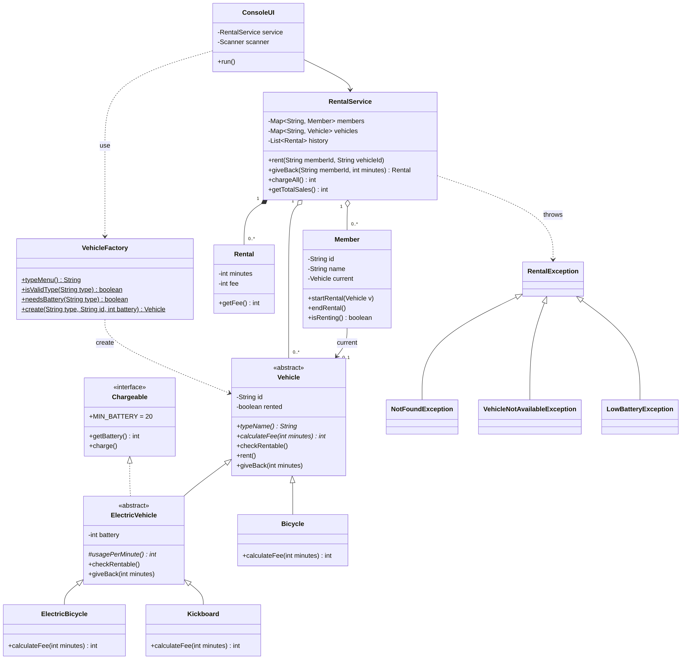

# 공유 킥보드·자전거 대여 시스템 (KICK)

객체지향프로그래밍 기말 팀 프로젝트 · A반 · 팀 KICK · 자유 주제

- **공동 개발 저장소**: https://github.com/jjp3932-droid/2026-OOP (`Final-Project/A-Class/KICK`)

## 1. 프로젝트 개요

- **프로젝트명**: 공유 킥보드·자전거 대여 시스템
- **개발 목적**: 일반자전거·전기자전거·전동킥보드를 빌리고 반납하는 과정을 객체지향으로 설계한다. 기기마다 요금 계산과 배터리 규칙이 다른 점을 상속·다형성·추상화로 표현한다.
- **주요 기능**

| 기능 | 내용 |
|---|---|
| 기기 목록 | 등록된 기기를 번호순으로 출력 (대여 상태, 전기 기기는 배터리) |
| 회원 목록·등록 | 회원번호와 이름으로 등록, 번호 중복·빈 값 불가 |
| 기기 등록 | 일반자전거 / 전기자전거 / 전동킥보드 선택 등록 (`VehicleFactory`가 생성) |
| 대여 | 회원 1명당 1대. 전기 기기는 배터리 20% 이상만 가능 |
| 반납·요금 계산 | 이용 시간(분)을 입력하면 기기별 요금표로 계산, 전기 기기는 배터리 감소 |
| 이용 내역 | 반납 기록과 매출 합계 출력 |
| 전체 충전 | 대여 중이 아닌 전기 기기를 100%로 충전 |

- **요금표**

| 기기 | 요금 | 10분 이용 | 배터리 사용 |
|---|---|---|---|
| 일반자전거 | 기본 1,000원 + 분당 100원 | 2,000원 | 없음 |
| 전기자전거 | 기본 1,000원 + 분당 150원 | 2,500원 | 1분에 1% |
| 전동킥보드 | 잠금해제 1,200원 + 분당 180원 | 3,000원 | 1분에 2% |

## 2. 팀 구성

| 이름 | 담당 범위 (커밋하고 발표 때 설명하는 코드) | 커밋 |
|---|---|---|
| 정재부 (팀장) | 기기 상속 구조(`Vehicle`, `ElectricVehicle`, `Chargeable`, 기기 3종), `Member`와 입력 검증, 클래스 다이어그램·README 제출 | 1차 버전, 02~06단계, 문서 |
| 오찬영 | 사용자 정의 예외, `RentalService`, `Rental`, `ConsoleUI`, `VehicleFactory`, 실행 스크립트 | 01단계, 07~13단계 |

## 3. 개발 환경

- 언어: Java (JDK 17 이상, JDK 21에서 실행 확인)
- 도구: IntelliJ IDEA, GitHub Desktop
- 외부 라이브러리: 없음 (Java 표준 라이브러리만 사용)
- 구현 형태: 콘솔 프로그램

## 4. 폴더 구조

```
KICK/
├─ README.md
├─ run.bat                      Windows 실행 스크립트 (컴파일 + 실행)
├─ run.sh                       macOS / Linux 실행 스크립트
├─ docs/
│  ├─ class-diagram.png         클래스 다이어그램
│  └─ 발표자료.pdf
└─ src/
   └─ rental/
      ├─ Main.java              시작점, 시연용 기본 데이터 등록
      ├─ model/
      │  ├─ Vehicle.java             추상 클래스: 모든 기기 공통 (번호, 대여 상태)
      │  ├─ ElectricVehicle.java     추상 클래스: 배터리 있는 기기 공통
      │  ├─ Chargeable.java          인터페이스: 배터리 조회·충전 규약
      │  ├─ Bicycle.java             일반자전거
      │  ├─ ElectricBicycle.java     전기자전거
      │  ├─ Kickboard.java           전동킥보드
      │  ├─ VehicleFactory.java      기기 종류 번호로 기기 객체 생성
      │  ├─ Member.java              회원 (현재 대여 기기, 대여 순서 검사)
      │  └─ Rental.java              이용 기록 1건 (불변)
      ├─ service/
      │  └─ RentalService.java       회원·기기 보관, 대여·반납·충전, 매출 합계
      ├─ exception/
      │  ├─ RentalException.java             업무 오류의 부모 예외
      │  ├─ NotFoundException.java           없는 회원·기기
      │  ├─ VehicleNotAvailableException.java 이미 대여 중인 기기
      │  └─ LowBatteryException.java         배터리 부족
      └─ ui/
         └─ ConsoleUI.java           메뉴 입력·출력, 예외 메시지 표시
```

## 5. 실행 방법

### 방법 1. 실행 스크립트 (가장 간단)

JDK 17 이상이 설치되어 있어야 한다 (`javac -version`으로 확인).

- Windows: `KICK` 폴더의 `run.bat`을 더블클릭하거나, 명령 프롬프트에서 `run.bat` 실행
- macOS / Linux: `KICK` 폴더에서 `sh run.sh`

스크립트가 `src`를 `out` 폴더로 컴파일한 뒤 `rental.Main`을 실행한다. 콘솔 한글은 UTF-8로 설정된다.

### 방법 2. IntelliJ IDEA

1. `File > Open`으로 `KICK` 폴더를 연다.
2. `File > Project Structure > Project`에서 SDK를 JDK 17 이상으로 선택한다.
3. `src` 폴더가 파란색이 아니면 우클릭 → `Mark Directory as > Sources Root`.
4. `src/rental/Main.java`의 `main` 옆 ▶ 버튼으로 실행한다.

### 방법 3. 명령어로 직접

```
cd KICK
javac -encoding UTF-8 -sourcepath src -d out src/rental/Main.java
java -Dfile.encoding=UTF-8 -cp out rental.Main
```

### 기본 데이터

실행하면 회원 2명(M1 정재부, M2 오찬영)과 기기 4대(B-01, E-01 80%, K-01 60%, K-02 15%)가 등록되어 있다. K-02는 배터리 부족 시연용이다.

메뉴: `1.기기 목록 2.회원 목록 3.대여 4.반납 5.이용 내역 6.전체 충전 7.회원 등록 8.기기 등록 0.종료`

## 6. OOP 적용 내용



| 원리 | 적용 클래스 | 적용 이유 |
|---|---|---|
| 은닉성 | `Vehicle.rented`, `ElectricVehicle.battery`, `Member.current` (모두 private) | 대여 상태와 배터리를 밖에서 직접 바꾸면 요금 없이 반납되거나 배터리 검사를 건너뛸 수 있다. `rent()`, `giveBack()`, `charge()`, `startRental()`, `endRental()`처럼 검사를 거치는 메소드로만 바뀌게 했다. `Member`는 기기 대여 처리를 건너뛴 호출도 거부한다. |
| 상속성 | `Vehicle` → `Bicycle`, `ElectricVehicle` → `ElectricBicycle`, `Kickboard` / `RentalException` → 예외 3종 | 기기 번호와 대여 상태는 모든 기기에 공통이라 `Vehicle`에 한 번만 둔다. 배터리 코드는 전기자전거와 킥보드가 똑같이 써서 `ElectricVehicle`에 모아 중복을 없앴다. |
| 다형성 | `RentalService`의 `Map<String, Vehicle>`, `vehicle.rent()`, `vehicle.calculateFee(minutes)`, `Chargeable` 타입 충전 | 서비스는 기기 종류를 if문으로 나누지 않는다. 부모 타입 `Vehicle`로 호출하면 실제 객체의 메소드가 실행된다(동적 바인딩). 전기 기기는 `rent()` 때 오버라이딩된 `checkRentable()`로 배터리 검사까지 수행된다. |
| 추상성 | 추상 클래스 `Vehicle`, `ElectricVehicle` / 추상 메소드 `calculateFee()`, `typeName()`, `usagePerMinute()` / 인터페이스 `Chargeable` | "모든 기기는 요금을 계산할 수 있다"는 규약만 부모에 정하고 계산식은 자식에게 맡겼다. 충전은 배터리가 있는 기기에만 해당해서 인터페이스로 분리했다. |

그 밖의 요소

- **생성자**: `super(id)`, `super(id, battery)`로 부모 생성자를 호출한다. 생성자에서 빈 번호·이름, 0~100 밖의 배터리를 거부한다.
- **오버라이딩**: 추상 메소드 구현, `ElectricVehicle`의 `checkRentable()`·`giveBack()`(부모 동작 + 배터리 처리), `toString()`·`equals()`·`hashCode()`.
- **컬렉션**: `LinkedHashMap<String, Member>`, `LinkedHashMap<String, Vehicle>`, `ArrayList<Rental>`.
- **패키지**: `model`(상태·규칙·객체 생성), `service`(흐름), `exception`(오류), `ui`(입출력).

SOLID 관점

- **SRP**: 기기는 요금·상태, 서비스는 대여 흐름, 팩토리는 객체 생성, UI는 입출력만 담당한다.
- **OCP**: 새 기기(예: 전동 스쿠터)는 `ElectricVehicle`을 상속한 클래스 1개와 `VehicleFactory`의 생성 코드만 추가한다. `RentalService`와 `ConsoleUI`는 수정하지 않는다.
- **LSP**: 어떤 기기를 `Vehicle` 자리에 넣어도 `rent()`, `giveBack()`, `calculateFee()`가 약속대로 동작한다. 배터리 부족 예외도 `RentalException`의 자식이라 호출하는 쪽은 같은 방식으로 처리한다.
- **ISP**: 충전 기능을 `Vehicle`에 두면 일반자전거도 `charge()`를 가져야 해서, 충전 가능한 기기만 `Chargeable`을 구현하게 했다.
- **DIP**: `RentalService`는 `Vehicle`, `Chargeable` 같은 추상 타입에만 의존한다. `ConsoleUI`도 `VehicleFactory` 도입 후 구체 기기 클래스를 import하지 않는다. `ConsoleUI`가 `RentalService` 구체 클래스에 의존하는 점은 남아 있다(서비스 인터페이스를 두면 개선 가능).

## 7. 생성형 AI 활용 내역

- **사용 도구**: Claude (Anthropic)
- **활용 수준**: 4단계 (바이브코딩 중심)

| 구분 | 활용 내용 |
|---|---|
| 설계 | 주제 후보 제안, 패키지·클래스 구조 초안, 클래스 다이어그램 |
| 코드 생성 | 1차 버전과 단계별 개선 코드 (01~13단계) |
| 오류 수정·테스트 | 시나리오 입력으로 실행 결과 확인, 예외 메시지 정리 |
| 문서 | README, 클래스 다이어그램, 발표 자료 |

**AI가 생성한 코드 중 팀이 검토·수정한 부분**

- 코드 작성과 단계별 개선(06단계 입력 검증, 10단계 숫자 입력 오류 수정, 12단계 `VehicleFactory` 분리 등)은 AI가 제안하고 생성했다.
- 팀은 단계별 결과물을 받아 내용을 확인한 뒤 담당 단계를 나눠 커밋했고, 각 단계에서 무엇이 왜 바뀌었는지 이해하는 데 집중했다. 팀이 코드를 직접 고친 부분은 없다.

**팀이 직접 결정한 객체지향 설계**

- 주제를 공유 킥보드·자전거 대여로 선택했다.
- 상속·인터페이스·팩토리 구조는 AI가 제안한 설계를 그대로 채택했다.

## 8. 기능 테스트 결과

기본 데이터 상태에서 순서대로 실행한 결과이다. 테스트 시나리오 작성과 실행은 AI가 했다. (JDK 21, 2026-11-25, 13단계 최종 코드)

| 번호 | 테스트 | 입력 | 결과 | 판정 |
|---|---|---|---|---|
| 1 | 기기 목록 | 1 | 4대가 번호순으로 출력, 전기 기기는 배터리 표시 | 정상 |
| 2 | 대여 | 3, M1, K-01 | `대여 완료: 전동킥보드 K-01` | 정상 |
| 3 | 대여 중인 기기 대여 | 3, M2, K-01 | `[오류] 이미 대여 중인 기기입니다: K-01` | 정상 |
| 4 | 배터리 부족 | 3, M2, K-02 | `[오류] 배터리가 부족합니다: K-02 (현재 15%, 20% 이상만 대여 가능)` | 정상 |
| 5 | 회원 중복 대여 | 3, M1, B-01 | `[오류] 정재부님은 이미 K-01 기기를 대여 중입니다.` | 정상 |
| 6 | 없는 회원 | 3, M9, B-01 | `[오류] 등록되지 않은 회원입니다: M9` | 정상 |
| 7 | 없는 기기 | 3, M2, X-99 | `[오류] 등록되지 않은 기기입니다: X-99` | 정상 |
| 8 | 대여 없이 반납 | 4, M2, 5 | `[오류] 오찬영님은 대여 중인 기기가 없습니다.` | 정상 |
| 9 | 이용 시간 0분 | 4, M1, 0 | `[오류] 이용 시간은 1분 이상이어야 합니다.` | 정상 |
| 10 | 숫자가 아닌 입력 | 4, M1, abc | `숫자로 입력하세요.` 후 다시 입력받음 | 정상 |
| 11 | 킥보드 반납 | 4, M1, 10 | `반납 완료: 정재부 \| 전동킥보드 K-01 \| 10분 \| 3000원`, 배터리 60% → 40% | 정상 |
| 12 | 자전거 반납 | 3, M2, B-01 → 4, M2, 10 | `10분 \| 2000원` | 정상 |
| 13 | 전기자전거 반납 | 3, M2, E-01 → 4, M2, 10 | `10분 \| 2500원`, 배터리 80% → 70% | 정상 |
| 14 | 이용 내역 | 5 | 3건 출력, `매출 합계: 7500원` | 정상 |
| 15 | 전체 충전 | 6 | `3대를 충전했습니다.` 전기 기기 3대 모두 100% | 정상 |
| 16 | 회원 등록 | 7, M3, 홍길동 | `회원 등록 완료: M3 홍길동` | 정상 |
| 17 | 회원번호 중복 | 7, M1, 중복 | `[오류] 이미 등록된 회원번호입니다: M1` | 정상 |
| 18 | 빈 회원번호 | 7, (빈칸), 이름 | `[오류] 회원번호를 입력하세요.` | 정상 |
| 19 | 빈 이름 | 7, M4, (빈칸) | `[오류] 이름을 입력하세요.` | 정상 |
| 20 | 배터리 범위 오류 | 8, 3, K-03, 150 | `[오류] 배터리는 0~100 사이여야 합니다: 150` | 정상 |
| 21 | 기기 등록 | 8, 3, K-03, 90 | `기기 등록 완료: [전동킥보드] K-03 (대여 가능) 배터리 90%` | 정상 |
| 22 | 기기번호 중복 | 8, 1, B-01 | `[오류] 이미 등록된 기기번호입니다: B-01` | 정상 |
| 23 | 빈 기기번호 | 8, 1, (빈칸) | `[오류] 기기번호를 입력하세요.` | 정상 |
| 24 | 잘못된 기기 종류 | 8, 9 | `기기 종류를 다시 선택하세요.` | 정상 |
| 25 | 팩토리로 전기자전거 등록 | 8, 2, E-02, 50 | `기기 등록 완료: [전기자전거] E-02 (대여 가능) 배터리 50%` | 정상 |
| 26 | 잘못된 메뉴 | 9 | `메뉴 번호를 다시 입력하세요.` | 정상 |

**개발 중 수정한 오류**

| 문제 | 원인 | 수정 (커밋) |
|---|---|---|
| 이용 시간에 글자를 넣으면 프로그램이 종료됨 | `Integer.parseInt()`의 `NumberFormatException`을 처리하지 않음 | `ConsoleUI.readInt()`에서 숫자가 입력될 때까지 다시 입력받음 (10단계) |
| 반납해도 킥보드 배터리가 줄지 않음 | 반납 시 배터리 처리 코드가 없음 | `ElectricVehicle.giveBack()`에서 `usagePerMinute() × 분`만큼 차감 (03단계) |
| 배터리 150, 빈 번호·이름으로 등록 가능 | 생성자에서 값을 검사하지 않음 | `ElectricVehicle`, `Vehicle`, `Member` 생성자에서 검사 후 예외 (03, 06단계) |

## 9. 객체지향 설계 개선 내용

첫 커밋(10주차 1차 버전)부터 최종 버전까지의 변경이다. GitHub 커밋 이력에서 단계별로 확인할 수 있다.

| 초기 설계 (1차 버전) | 문제 | 최종 설계 | 관련 원칙 | 단계 |
|---|---|---|---|---|
| 배터리 필드가 `Kickboard`에만 있음 | 전기자전거를 추가하면 배터리 코드가 중복됨 | `ElectricVehicle` 추상 클래스와 `Chargeable` 인터페이스로 분리 | 상속, ISP | 03, 04 |
| `RentalService`가 `instanceof Kickboard`로 배터리 검사 | 전기 기기가 늘 때마다 서비스 코드를 수정해야 함 | 검사를 `checkRentable()` 오버라이딩으로 이동, 서비스는 `vehicle.rent()`만 호출 | OCP, 다형성 | 02, 03, 07 |
| `ArrayList`에서 for문으로 id 검색 | 검색 코드가 반복됨 | `Map<String, Vehicle>`, `Map<String, Member>`로 검색 | 컬렉션 활용 | 07 |
| 실패하면 문자열 메시지를 반환 | 호출한 쪽에서 성공·실패를 구분하기 어려움 | 사용자 정의 예외 4종을 던지고 `ConsoleUI`에서 `try-catch` | SRP | 01, 07 |
| `Member.setCurrent()`로 아무 때나 기기 변경 | 대여·반납 순서가 어긋나도 막을 수 없음 | `startRental()` / `endRental()`로 바꾸고 순서 검사 | 은닉성 | 05, 06 |
| 이용 기록이 남지 않음 | 매출을 알 수 없음 | `Rental` 클래스와 이용 내역·매출 합계 | 책임 분리 | 08 |
| (11주차 SOLID 검토) `ConsoleUI.registerVehicle()`이 if-else로 `new Bicycle()` 등을 직접 호출 | 기기를 추가할 때마다 UI를 수정해야 하고, 입출력 클래스가 구체 기기 3개에 결합됨 | `VehicleFactory.create(종류, 번호, 배터리)`가 생성을 전담하고 `Vehicle` 타입으로 반환 | OCP, DIP, SRP | 12 |
